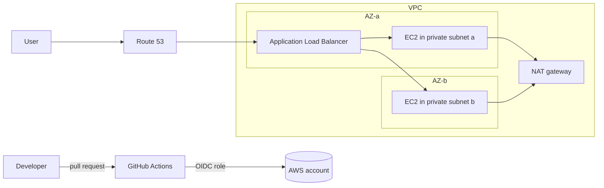

# ☁️ CloudForge

## 📘 A Multi-AZ AWS Environment Defined Entirely in Terraform and Deployed by a Pipeline

I built this project to learn what separates infrastructure I clicked together in the AWS console from infrastructure I can destroy and rebuild from code, review in a pull request, and deploy without a long-lived access key. A single EC2 instance is the easy version. The version I wanted to understand has a custom network across two Availability Zones, a load balancer in front of an Auto Scaling group, remote state, and a pipeline that plans on every pull request and applies on merge.

It is a lab project, not a production design.

I wrote the architecture down first, split the Terraform into three reusable modules (`network`, `compute`, `dns`), and then added a GitHub Actions pipeline that authenticates to AWS with OIDC and runs Checkov before anything can be applied.

---

## ✅ Verification

| Check | Result |
|---|---|
| Architecture, module layout, variable list | Complete in `docs/architecture.md` |
| Terraform modules: network, compute, dns | Written in `terraform/modules/` |
| Bootstrap (state bucket, OIDC provider, deploy role) | Written in `bootstrap/` |
| GitHub Actions: fmt, validate, Checkov, plan, apply | Written in `.github/workflows/terraform.yml` |
| `terraform validate` | Not yet run |
| Checkov scan of `terraform/` and `bootstrap/` | **0 failed** (52 and 27 passed), 16 skips with reasons in `.checkov.yaml` |
| `terraform apply` in a real AWS account, teardown and rebuild time | Results go in `docs/deploy-log.md` |

Nothing here has been deployed yet. Results are recorded in `docs/deploy-log.md` as I run them.

---

## 🧠 Skills I Developed

### **Infrastructure as Code**
- Splitting a stack into reusable modules with clear inputs and outputs
- Remote state in S3 with locking, and a bootstrap step to create it
- Variables, outputs, and an example `tfvars` file instead of hard-coded values

### **AWS Networking & Compute**
- VPC with public and private subnets across 2 Availability Zones, route tables, internet gateway, and NAT gateway
- Application Load Balancer, target group, and health checks
- Launch template and Auto Scaling group running a Docker container
- Route 53 alias record and an ACM certificate validated by DNS

### **CI/CD & Security**
- GitHub Actions with OIDC, so there are no stored AWS access keys
- Plan on pull requests, apply only on merge to `main`
- Checkov scanning in the pipeline, with every skipped check written down with a reason

---

## ⚡ What I Built

- A `network` module: VPC, 2 public subnets, 2 private subnets, IGW, NAT gateway, route tables
- A `compute` module: ALB, target group, launch template, Auto Scaling group, security groups
- A `dns` module: optional ACM certificate and Route 53 alias record
- A bootstrap stack for the state bucket and the GitHub OIDC role
- A pipeline that formats, validates, scans, plans, and applies

### Architecture



---

## 🛠️ Tech Stack

| Layer | Technology |
|---|---|
| Infrastructure as Code | Terraform |
| Network | VPC, subnets, IGW, NAT gateway, route tables |
| Compute | EC2 Auto Scaling, launch template, Docker |
| Traffic | Application Load Balancer, Route 53, ACM |
| State | S3 remote state with locking |
| CI/CD | GitHub Actions with OIDC |
| Security scanning | Checkov |

---

## 🚀 Run It

```bash
git clone https://github.com/lucckkyyy/cloudforge-aws-platform.git
cd cloudforge-aws-platform

# 1. Create the state bucket and GitHub OIDC role (once)
cd bootstrap
terraform init && terraform apply

# 2. Deploy the stack
cd ../terraform
cp terraform.tfvars.example terraform.tfvars
terraform init
terraform plan
terraform apply

# 3. Tear it down
terraform destroy
```

Run `terraform destroy` when you are done. The NAT gateway and load balancer cost money while they exist.

```
cloudforge-aws-platform/
  bootstrap/          state bucket, OIDC provider, deploy role
  terraform/          root module and variables
    modules/          network, compute, dns
  .github/workflows/  terraform.yml
  docs/               architecture, deploy-log
```

---

## 🚀 The Learning Outcome

The main lesson was that the resources themselves are the smaller part. The real work was the parts around them: where state lives, how the pipeline proves who it is without a stored key, what stops an insecure change from being applied, and how to destroy the whole thing cleanly. Writing the pipeline so a pull request only plans and only a merge applies made those decisions explicit.

---

*Author: Aryan Rajguru*
